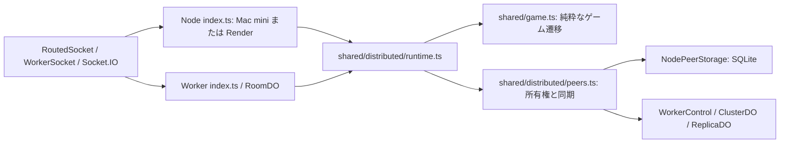
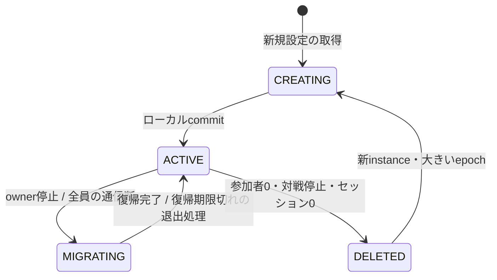

# ETB サーバー構成・ライフサイクル監査

監査基準: 2026-10-21、改修前 `main`。本書はコード監査とローカル検証の記録であり、本番の停止演習の記録ではない。

## 現状の構成と状態の所有者

Mac mini と Render は同じ `backend/server/src/index.ts` を起動する。Worker は Socket.IO サーバーではなく Native WebSocket を使い、ブラウザの `WorkerSocket` が既存イベント形式へ変換する。これを Socket.IO へ置換しない。

| 責務・入口         | 実装                                                                                                     | 状態の所有者・イベントの流れ                                                                                                                                     |
| ------------------ | -------------------------------------------------------------------------------------------------------- | ---------------------------------------------------------------------------------------------------------------------------------------------------------------- |
| 接続・再接続       | `frontend/lib/room/socket.ts`, `routedSocket.ts`                                                         | RoutedSocket がタブのJWT、接続世代、pending command、退出意図を保持。WorkerSocket はフレーム/heartbeatのみ。Socket.IOの自動再接続は分散モードで無効              |
| サーバー候補・信頼 | `shared/clusterConfig.ts`, `topology.ts`, frontend `serverUrl.ts`, `clusterConfig.ts`                    | ETB_CLUSTER_CONFIG の順序と `/ws` が優先度とtransportを定義。単独のHTTP到達性でownerを決めない                                                                   |
| 障害検知・選択     | `healthProbe.ts`, `routedSocket.ts`, peers `read/report/promote`                                         | `/health` は到達性のみ。foregroundで約1.25秒のcluster応答断→下位に障害報告→owner probe→checkpointがある有資格候補が昇格。正常復旧したPrimaryへ自動failbackしない |
| ルーム設定・作成   | Node `createRoomIfNeeded`, `lib/get.ts`; Worker `ensureDistributed`, `lib/database.ts`; `shared/room.ts` | PostgreSQL/PostgRESTは新規ルームの設定・問題取得のみ。NodeはpendingRoomLoadsで同時ロードを合流。稼働状態はDBへ保存しない                                         |
| 参加・退出・復帰   | Node socket handlers、RoomDO `handle/disconnect/alarm`、DistributedRoom `connect/leave/disconnect/tick`  | JWTのsessionIdがタブのプレイヤーID。transport IDは世代。認証は観戦接続、room:joinは座席追加。退出後も接続を残して再参加できる                                    |
| ゲーム状態         | `shared/types.ts`, `game.ts`, `protocol.ts`                                                              | 純粋reducerが唯一のルール。実行部がGameStateと絶対期限を持つ。NodeGameAdapterのtimerとWorker Alarmは環境固有                                                     |
| 所有権・同期       | `shared/distributed/{types,peers,replication,identity,link,runtime}.ts`                                  | PeerControlがinstance/epoch/revision/promise/checkpoint/tombstone。runtimeのキューがルーム内操作を直列化。差分hash不一致時はfullを再取得                         |
| 永続化             | `server/src/lib/peerStorage.ts`, `cloudflare/src/{ClusterDO,lib/cluster}.ts`                             | NodeはSQLite FULL同期と排他ロック、WorkerはReplicaDOにルーム単位のvote保存。bootと投票状態を一緒に維持する                                                       |
| 認証・認可         | frontend `auth.ts`, Node/Worker `lib/auth.ts`, `shared/{jwtPolicy,roomJwt,sessionJwt}.ts`                | 既存ES256 room JWT + room-bound session JWTを暗号検証後にIDとして使用。room ID、audience、issuer、expiry、kidを共通方針で検証                                    |
| ページ終了         | `shared/distributed/pageExit.ts`, `/cluster/leave`, `RoutedSocket.closePage`                             | beaconはroom JWT + session JWT + expectedInstance + connectionIdで古いページの退出をfence。配送失敗時は通常の切断期限が最終清掃                                  |
| timeout/retry      | `link.ts`, `routedSocket.ts`, runtime/RoomDO                                                             | peer接続約1.5秒、route/report HTTP 6秒、transport handshake 1.2秒、入力100ms集約、full snapshot 5秒。復旧retryは最大60回。分類された永続状態喪失は停止           |
| 停止・復旧         | PeerControl confirm/probe/promote、Node保守tick、RoomDO alarm                                            | SIGKILLからSQLite/DOのcheckpointで復元。drainingは譲渡を許可。旧ownerは新epochを観測すると停止。ルーム不明時にDBから対戦を捏造しない                             |

## 発見した問題と変更方針

1. **期限・退出・削除の責務が混在**。Nodeのsocket closure、Workerのclose/error/alarm、DistributedRoom、PeerControlの削除前検査に同じ判定がある。特にNode単独の対戦中disconnectは即時退出、Workerは20秒待つ。sharedの小さな純粋policyへ期限計算・空ルーム条件を集約し、timer/Alarmは各adapterに残す。
2. **重複disconnectで期限を更新**。runtimeとWorkerはclose/errorが重なるたびに `now + grace` へ更新する。再実行は最初の期限を維持し、新しい認証成功時だけ解除する。
3. **接続世代の境界が弱い**。page beaconにはconnectionId fenceがあるが通常disconnectにadapterから渡していない。認証置換と非同期disconnectの順序が逆転すると新しいsessionを切断し得る。runtimeが直列キュー内でIDを比較する。
4. **停止したruntimeのleaveが成功扱い**。halted/deletedで黙ってreturnしadapterがACKする。未確定退出をクライアントが捨てる恐れがある。haltedはエラーにしてACKしない（削除済みは既に退出済みで冪等成功）。
5. **認証処理が非同期に重なる**。Nodeは同一socketが別room/sessionに再認証でき、前のliveSessionsやroomに残り得る。認証を接続単位に直列化し、最初に成功したID/roomへ束縛する。置換済みsocketからのゲーム操作も拒否する。
6. **障害ログの情報不足とfloating promise**。Node入力などの非同期apply、Worker alarm復元失敗の経路で原因を追いにくい。失敗を記録し、停止時に誤ったACKを送らない。正常な入力ごとのログは増やさない。
7. **snapshotの世代比較が不統一**。ブラウザは同じinstanceの場合だけ古さを比較し、遅延した別instanceが版の基準をリセットできる。`distributed/version.ts` でepoch/revision順を共通化し、新instanceには必ず大きいepochを要求する。route/reportでも古いtombstoneや不明なinstanceの応答を選ばず、他の並列readの成功を待つ。同じinstanceのactive routeは複製遅延でrevisionが少し古くても接続可能だが、snapshotの版基準は下げない。
8. **構成parserの複製**。frontend/backendのclusterConfig.tsは完全に同じ実装だった。frontendからsharedを再exportし、Nextのbundle rootをリポジトリへ設定する。
9. **文書と現実の不一致**。DISTRIBUTED.mdには削除済みの署名/CA/quorum保証の記述が残る。現方式の保証を訂正し、テストを「全本番保証」と解釈しない。

## 最小限の責務分担

- **Connection/Server selection**: 既存RoutedSocketとWorkerSocketを維持。ゲーム状態は所有させない。readを並行、promoteを誘発するreportを逐次実行する。既存の回帰テストで順序を保護する。
- **Session policy**: `shared/session.ts` のデータ型・純粋関数。参加者と観戦接続を区別、明示退出と通信断を区別、絶対期限を計算。クラスやtransport/ストレージ依存を持たせない。
- **Room lifecycle / Game execution**: DistributedRoomがセッションとゲームの一貫した変更を直列化。shared policyを利用する。NodeGameAdapter / RoomDOはtimer/Alarmと送信を担当する。
- **State synchronizer / authority**: 既存PeerControl + link/replication。runtimeと削除前検査で同じ空ルーム条件を使う。Node/Workerの保存方式はadapterで分ける。
- **Auth boundary**: JWT暗号検証は各adapter、claims policyはshared。公開peer declarationは認証ではない。

新しいDB・外部サービス・依存パッケージ・巨大Managerは追加しない。シリアライズされるcheckpointと公開イベント形式を変えない。

## 変更してはいけない仕様

- タブごとに別sessionId。再接続は同じJWTを再使用、reloadは別人。transport IDをプレイヤーIDに戻さない。
- 明示 `room:leave` は即座に座席を除去、対戦中の退出は既存仕様通り対戦キャンセル/参加者クリア。例外として脱落者の座席はholder indexを守るため試合終了まで保持するが、接続sessionは通常通り清掃する。これは既存のゲーム規則であり変更しない。
- 認証された観戦者がいる空のルームは保持する。「最後の座席の退出」と「最後の接続の終了」は別。全接続と期限待ちがなく、対戦も参加者もない場合だけ削除する。
- lobbyの確定disconnectは即時除去。対戦プレイヤーの通信断は最低20秒の復帰猶予。Node分散の観戦接続の期限は8秒、Workerは20秒。期限切れの参加者は観戦者が残っていても退出させる。
- 分散モードでは全員の通信断・移行中にゲーム期限を停止し、全員復帰または20秒後に再開/通常退出。繰り返し通知・runtime再openで猶予を更新しない。
- 同一sessionの接続置換は旧接続を無効化。旧closeやbeaconで新接続を除去しない。
- ACKはcommit成功後だけ。旧instance/epoch/revisionの操作やsnapshotで現在の状態を戻さない。削除tombstoneと永続投票状態は勝手に消さない。

## 状態遷移と退出の流れ

明示退出: verified socket identity → serialized leave → reducer → commit → broadcast → requestId ACK。接続中はsessionを維持する。ページ終了はinstance/connectionを照合して座席を直ちに除去し、実socketが残る場合は認証を保持する。通信断: 最新接続か確認 → lobbyなら即時除去、対戦なら最初の絶対期限を保存 → 再認証なら期限解除 → tick/Alarmで期限切れをreducerへ適用 → 空ルーム検査 → tombstone確定。猶予中の単なる切断で `room:leave` を発行しない。

## 所有権の監査結果と保証の限界

既にepoch、固定voter、boot、永続promise、revision、tombstoneを持つ。新しい名前でfencing tokenを追加するだけでは分断を解決しない。通常通信・クラッシュ回復では古いepochを拒否し、復旧した旧ownerは新ownerのepochを確認して停止する。

**「常に有効owner最大1」は現方式では成立しない。** `PeerControl.quorum()` は可用性を優先する1票で、孤立した旧ownerも下位候補も進行できる。epochが同値になる分岐もあり、接続回復まで二重進行や操作消失を防げない。確認前のローカルcommitは下位未配送のまま失われ得る。既存 `peerConsensus.test.ts` の分断テストがこの動作を明示する。ブラウザの版比較は古いsnapshotの巻き戻しを防ぐが、孤立owner間の履歴を統合する機能ではない。

厳密保証には、既存SQLite/ReplicaDOのpromiseを使う**交差する固定多数派**で選出と全commitを認め、少数派で進行を停止する変更が必要。3台構成なら単独Worker/単独Renderは進めなくなる。代替のリースも合意した期限・時計誤差・旧ownerの停止条件が必要で、単に20秒のタイマーを入れても保証にはならない。今回の互換改修では単独継続の既存仕様を保持する。この不変条件は未達として残し、保証済みと記載しない。

peer通信はTLS + 公開構成照合のみで暗号的相互認証がない。接続可能な第三者はpeerを偽装できる。JWTによるプレイヤー認証とは別の問題。既存方針を無断で鍵方式に戻さず、ネットワーク制限または相互認証の別途合意を推奨する。

## テスト設計

変更前baseline: `npm test --prefix backend/server` 159/159、`npm test --prefix backend/cloudflare` 6/6。

既存core/adapterテストはゲーム規則とtimer、distributedRuntimeは擬似clock + Controlのイベント列、peerConsensusは実PeerControl間の通信fixture、peerLinkは実WebSocketを使う。Cloudflare `distributed.integration.mjs` は実Node子プロセス + Socket.IO + workerd + ChromiumでMac停止、Worker停止、Render単独/再起動、データ喪失、ページ終了、再参加を検証する。DB設定取得のみローカルHTTP fixture。ネットワーク分断はインメモリpeer経路遮断であり、本番WAN分断の証拠ではない。

新規テストは重複切断・接続世代逆転・halt後の退出・同一socket再認証・単独adapterの20秒復帰/最終削除を対象に、イベント列と最終stateを検査する。繰り返し実行は回数を指定できる専用コマンドにする。実行コマンド・成功/失敗・未実施は [検証記録](server-lifecycle-validation.md) に保存する。

## 今後の課題

- 厳密所有権と単独継続の優先順位を決め、選出・commit方式を同時に変更する。部分的なquorum変更では安全にならない。
- 実ホスト間の遅延/時計差/片方向分断/Renderスリープと永続ディスク喪失を、監視付きステージング演習で測定する。ローカル所要時間を本番SLOにしない。
- peer相互認証を再検討する。復旧失敗コードとcheckpoint欠損の監視を整備する。
- tombstoneの保持容量、ClusterDOの接続集中、best-effort複製遅延、初期cohort外の後発ノードの扱いを運用監視する。

Worker Alarmはat-least-onceであるため冪等な期限処理が必要（[公式Alarm仕様](https://developers.cloudflare.com/durable-objects/api/alarms/)）。設計確認には [Workers best practices](https://developers.cloudflare.com/workers/best-practices/workers-best-practices/) とインストール済み型定義を参照する。

## 実装レビューの結論

共通化はセッション型・猶予計算・空ルーム条件・ゲームルール・版順序・公開構成parserに限定した。NodeのタイマーとWorkerのAlarm、JWT鍵のロード、DB接続、ログ出力はadapterに残す。既存のControl境界を再利用し新しいManagerは作らない。Nodeの同一socket認証を直列化しroom/sessionを束縛、Workerでも同じID制約を適用する。Worker単独でも既存room:leave:ackをcommit後に返す。新規回帰テストが旧実装で失敗するため、テストと修正を同一PRにまとめ、監査と検証記録を同梱する。
